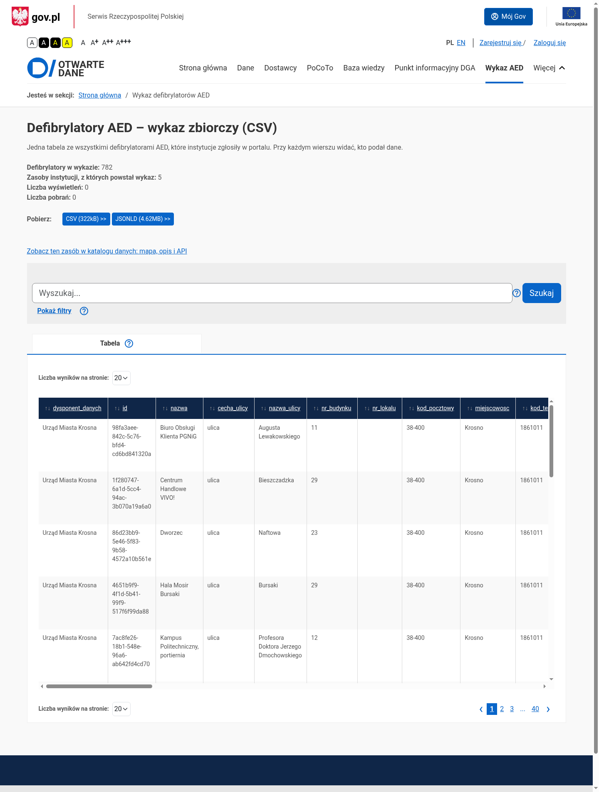

# Mapa serc – instrukcja dla jury

Zadanie: „Misja AED – dane na ratunek”. Poniżej są kroki, w których sprawdzicie każde wymaganie osobno: co otworzyć, co tam zobaczyć i gdzie leży to w kodzie.

- **Prototyp:** https://panel-boom-brush-certainly.trycloudflare.com/ (adres tymczasowy, działa, dopóki działa nasz komputer z tunelem)
- **Dokumentacja API:** https://panel-boom-brush-certainly.trycloudflare.com/api/docs
- **Wykaz AED w portalu dane.gov.pl:** portal stoi na naszym komputerze, nie pod publicznym adresem. Zrzut ekranu i kroki są w sekcji „Wykaz AED w portalu dane.gov.pl” niżej.
- **Token administratora** (krok 5) jest w opisie zgłoszenia na platformie. Nie trzymamy go w repozytorium.
- **Przykładowy plik urzędu** do kroku 4: [zgloszenie/przyklad-pliku-urzedu.csv](zgloszenie/przyklad-pliku-urzedu.csv). Urządzenia w nim są zmyślone i mają to w nazwie.

## Jak działa całość, w jednym akapicie

Każdy dysponent (gmina, szpital, firma) publikuje w dane.gov.pl **własny** zbiór z danymi o swoich AED i sam za niego odpowiada. Mapa serc pomaga mu przygotować te dane według jednego wzorca: wczytuje plik w dowolnym układzie, poprawia go i wydaje gotowy plik CSV oraz plik XML dla harvestera portalu. **Portal** co noc zbiera wszystkie zbiory oznaczone tagiem `wykaz-aed` w jeden **wykaz zbiorczy**, tak jak dziś składa „Wykaz chronionych danych” (DGA), i pokazuje go jako tabelę na własnej stronie „Wykaz AED”. Pierwsza kolumna tabeli mówi, który dysponent dostarczył wiersz. Tę zmianę w kodzie portalu (backend i strona) opisuje [portal/README.md](portal/README.md).

## Wykaz AED w portalu dane.gov.pl

To najważniejsza część rozwiązania: dane są zasobami portalu, a tabela wykazu jest stroną portalu.

Portal postawiliśmy u siebie z kodu źródłowego (backend 2.62.3, frontend 3.5.2) i nałożyliśmy na niego naszą zmianę. Na zrzucie jest strona `/pl/aed/table` lokalnego portalu: 782 defibrylatory od 5 instytucji.

1. **Na czym się wzorowaliśmy.** Portal ma już „Wykaz chronionych danych” (DGA): zasoby wielu instytucji scalone w jedną tabelę na stronie `/pl/dga/list-protected-data/table`. Wykaz AED działa i wygląda tak samo, a różni się zakresem kolumn (34 kolumny wzorca danych AED i 3 kolumny o dysponencie).
2. **Zasilenie automatyczne.** Cztery instytucje (Warszawa, Krosno, Przemyśl, Marki) trafiły do portalu przez harvester. Portal pobrał plik XML każdej z nich z Mapy serc, założył zbiór pod jej nazwą i pobrał plik CSV.
3. **Zasilenie ręczne.** Zbiór i plik Legionowa dodaliśmy formularzami panelu administracyjnego portalu. Plik bez wymaganych kolumn panel odrzuca i wymienia, których brakuje.
4. **Wykaz.** Nocne zadanie portalu scaliło pięć zasobów w jeden zasób CSV w zbiorze Ministerstwa Cyfryzacji. Po dodaniu piątej instytucji podmieniło plik w tym samym zasobie, więc adres się nie zmienił.
5. **Tabela w portalu.** W menu portalu jest pozycja „Wykaz AED”. Strona pokazuje tabelę wykazu, wyszukiwarkę z filtrami i pliki do pobrania. Ten sam zasób ma w katalogu danych mapę z 782 punktami: [zrzut](portal/zrzuty/wykaz-aed-mapa-w-katalogu.png).

Jak postawić portal u siebie i powtórzyć te kroki: [portal/README.md](portal/README.md#jak-postawić-portal-u-siebie). Lista zmienionych plików portalu jest tam w sekcji „Co zmienia się w kodzie portalu”.

## Ścieżka przez prototyp, krok po kroku

1. **Znajdź AED** (strona główna). Pozwól na lokalizację albo wpisz adres. Zobaczysz najbliższe urządzenia z czasem dojścia, a przy każdym informację, czy jest dostępne teraz. „Prowadź mnie” prowadzi pieszo do urządzenia.
2. **Skąd te dane** (`/jakosc`; w menu wybierz „O projekcie”, sekcja „Otwarte dane”). Tu widać wszystkie źródła, co w każdym poprawiliśmy i zakres danych każdego źródła na tle wzorca (tabela na dole strony). Przy każdym dostawcy są dwa linki: „dane we wzorcu (CSV)” i „plik dla harvestera (XML)”. To jest to, co dostawca publikuje w portalu pod własnym szyldem.
3. **Wzorzec danych** (`/wzorzec`, ta sama sekcja). Opis 34 pól i pliki do pobrania, w tym skoroszyt XLSX (ten sam co [zgloszenie/wzorzec-danych-aed.xlsx](zgloszenie/wzorzec-danych-aed.xlsx)).
4. **Zgłoś urządzenia** (przycisk w prawym górnym rogu, `/dostawca`). Wybierz „Lista z pliku”, wgraj [zgloszenie/przyklad-pliku-urzedu.csv](zgloszenie/przyklad-pliku-urzedu.csv) i przejdź kreator:
   - system sam dopasuje kolumny,
   - pokaże poprawki: adres rozdzielony na ulicę i numer, przecinek dziesiętny, zamienione współrzędne w trzecim wierszu, godziny zapisane w jednolitej składni,
   - na końcu podaj nazwę dostawcy (np. „Jury – test”) i licencję CC0.

   Zgłoszenie dostaje stan „czeka na zatwierdzenie”.

   Jeden defibrylator zgłosi też każdy, bez pliku i bez logowania: wróć na `/dostawca` i wybierz „Jeden defibrylator”. Wpisz adres (np. Legionowo, Piłsudskiego 41) albo ustaw pinezkę na mapie, a formularz pokaże najbliższy adres i ostrzeże, jeśli obok jest już znane urządzenie. Podaj nazwę miejsca (np. „Jury – test”) i wyślij.
5. **Panel administratora** (`/admin`, strona nie jest w menu). Wpisz token, a potem przy swoim zgłoszeniu kliknij „Zatwierdź”. Panel pokaże link „Plik dla dane.gov.pl”. Przycisk „Odrzuć” usuwa zgłoszenie razem z jego urządzeniami. Pojedyncze urządzenia czekają w sekcji „Pojedyncze urządzenia” (po wpisaniu tokenu kliknij „Odśwież”). Po zatwierdzeniu urządzenie jest na mapie i we wspólnym źródle „Mapa serc (zgłoszenia użytkowników)” na stronie „Skąd te dane”, z własnym plikiem XML.
6. **Otwórz ten plik XML.** To zbiór jednego dostawcy w formacie harvestera dane.gov.pl (schemat 1.13). Zwróć uwagę na trzy rzeczy:
   - tytuł z nazwą dostawcy,
   - tag `wykaz-aed`,
   - zasób CSV z danymi tylko tego dostawcy.

   Ten adres dostawca podaje w portalu jako źródło danych swojej instytucji. Pod tym samym adresem z końcówką `.md5` jest suma kontrolna pliku, której wymaga harvester portalu.
7. **Urządzenia na mapie i raport urządzenia.** Wróć do „Znajdź AED” i kliknij urządzenie, np. z Warszawy. Karta urządzenia pokazuje, skąd są dane. Z niej przejdziesz do raportu urządzenia (`/aed/{id}`) i naklejki z kodem QR do wydruku.
8. **Gdzie brakuje AED** (`/braki`). Mieszkańcy bez sprawnego defibrylatora w zasięgu 400 m, z podziałem na godziny tygodnia, oraz najlepsze miejsca na nowe urządzenia.
9. **Radar AED** (`/radar`). Wskazówki, kogo poprosić o dane: gminy, które kupiły AED (ogłoszenia z e-Zamówień), i urządzenia znane tylko z mapy społeczności.

## Gdzie sprawdzić każde wymaganie z treści zadania

| Wymaganie | Gdzie to zobaczyć | Gdzie w kodzie |
|---|---|---|
| Zebranie danych z wielu rozproszonych źródeł | krok 2: 5 zbiorów samorządów z dane.gov.pl (782 urządzenia) i OpenStreetMap jako osobna, niepotwierdzona warstwa | `apps/api/sources/`, `apps/api/src/pipeline/` |
| Wskazanie referencyjnego zakresu każdego źródła | krok 2, tabela „zakres danych”; plik `/dane/zakres-zrodel.csv` | `apps/api/src/pipeline/coverage.ts` |
| Integracja danych od wszystkich dysponentów w jednym zbiorze | wykaz zbiorczy w portalu: sekcja „Wykaz AED w portalu dane.gov.pl” wyżej i [portal/README.md](portal/README.md); podgląd scalonej listy: `/dane/aed.csv` | `portal/mcod-backend.patch` |
| Wzorcowy zakres danych (XLSX) | [zgloszenie/wzorzec-danych-aed.xlsx](zgloszenie/wzorzec-danych-aed.xlsx), krok 3 | `packages/schema/src/fields.ts` |
| Zgodność z zasadami portalu dane.gov.pl | kroki 5–6: zbiór każdego dostawcy pod jego instytucją, licencje z listy portalu (CC0 1.0, CC BY 4.0), plik XML zgodny z oficjalnym schematem harvestera i suma kontrolna `.md5` obok niego. Harvester lokalnego portalu przyjął te pliki | `apps/api/src/publish/harvester.ts`, `apps/api/src/handlers.ts`; test ze schematem XSD portalu: `apps/api/test/pipeline.test.ts` |
| Zmiana w logice portalu: scalanie wykazów w jedną listę | [portal/README.md](portal/README.md): co robi, porównanie z wykazem DGA, lista zmienionych plików | `portal/mcod-backend.patch`, testy: `portal/run-tests.sh` |
| Tabela wykazu na stronie portalu | sekcja „Wykaz AED w portalu dane.gov.pl” wyżej: strona `/pl/aed/table`, pozycja „Wykaz AED” w menu | `portal/mcod-frontend.patch` |
| Zasilenie ręczne i automatyczne | ta sama sekcja, kroki 2 i 3; opis w [portal/README.md](portal/README.md#zasilenie-ręczne-i-automatyczne) | `portal/dane-pokazowe.py`, `mcod/resources/forms.py` w zmianie backendu |
| Format odczytywalny maszynowo | `/dane/aed.csv`, `/dane/aed.geojson`, `/dane/aed.jsonld`, `/dane/aed.csv-metadata.json` (CSVW), `/dane/schema.json` (Table Schema) | `apps/api/src/publish/files.ts` |
| Zachęcenie dysponentów do udostępniania | kreator i zgłoszenie jednego urządzenia przez każdego (krok 4), Radar (krok 9), naklejki QR i raport urządzenia (krok 7), przypomnienia o terminach elektrod i baterii | `apps/web/components/wizard/`, `apps/web/components/device-form/`, `apps/api/src/submission/`, `apps/api/src/radar/`, `apps/api/src/passport/` |
| Nazwa akcji i hasło | „Mapa serc – dane na ratunek”, nagłówek każdej strony | `apps/web/lib/brand.ts` |
| Strona o akcji | „O projekcie” (`/o-projekcie`, link w menu i w stopce): czym jest Mapa serc, wejście do każdej części serwisu, aplikacja mobilna, ile urządzeń znamy dziś i strony o danych | `apps/web/app/(site)/o-projekcie/page.tsx` |
| Logotyp (JPG, PNG, PDF, format otwarty) i księga znaku (PDF) | UZUPEŁNIĆ: ścieżki plików w `zgloszenie/` | |
| Responsywność | każda strona działa w szerokości telefonu i komputera | `apps/web/` |
| Dostępność (WCAG 2.2 AA) | przycisk „Dostępność” w nagłówku: wielkość tekstu A, A+, A++ i wysoki kontrast (biały i żółty na czarnym). Strona „Dostępność” (link w panelu i w stopce): obsługa samą klawiaturą i czytnikiem ekranu, mapa z klawiatury, powiększenie do 400% bez przewijania w bok, ustawienia systemu (większy kontrast, tryb dużego kontrastu Windows, mniej ruchu), znaczki na ikonach mapy dla osób nierozróżniających czerwieni i zieleni. Test axe-core (WCAG 2.2 A/AA) bez błędów na każdej stronie | `apps/web/components/display-settings.tsx`, `apps/web/app/globals.css`, `apps/web/app/(site)/dostepnosc/page.tsx`, `apps/web/components/aed-icon.tsx` |
| Użycie AI | opis w zgłoszeniu na platformie | |

## Uruchomienie u siebie

Opis jest w [README.md](README.md#uruchomienie). Zmianę w kodzie portalu nakłada `portal/apply-patch.sh`, a testuje `portal/run-tests.sh` (potrzebny Python z pandas, openpyxl, pytest i django albo Nix). Cały portal stawia `portal/portal-lokalnie.sh` (Podman) albo kroki z Dockerem z [portal/README.md](portal/README.md#jak-postawić-portal-u-siebie).

## Ograniczenia, o których warto wiedzieć

- Portal ze zmianą działał na naszym komputerze, nie pod publicznym adresem. Stronę portalu uruchomiliśmy na serwerze deweloperskim; produkcyjnej budowy frontendu nie robiliśmy, a nowa strona nie ma testów jednostkowych. Formularze panelu przy zasileniu ręcznym wysyłaliśmy skryptem. Po podmianie pliku tabela w portalu odświeża się do 15 minut, bo API portalu trzyma odpowiedzi w pamięci podręcznej. Szczegóły w [portal/README.md](portal/README.md#sprawdzenie-w-działającym-portalu).
- Logowanie przez mObywatel jest w wersji pokazowej: zamiast login.gov.pl jest ekran z przykładowymi osobami.
- E-maile i SMS-y bez skonfigurowanej bramki trafiają tylko do dziennika wiadomości (`/admin/outbox`).
- Dane z OpenStreetMap (ODbL) pokazujemy jako niepotwierdzone i nie trafiają do plików dla portalu, bo portal nie ma tej licencji na swojej liście.
