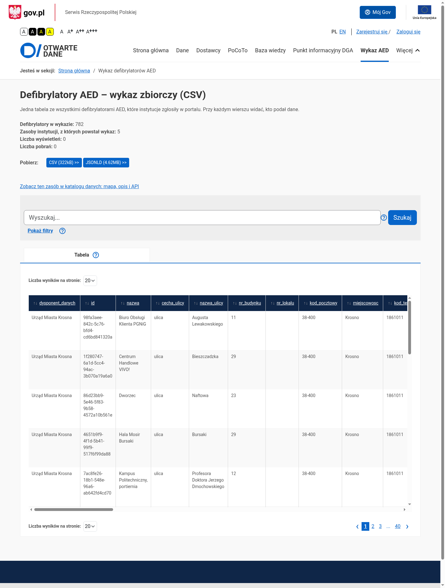

# Wykaz AED w portalu dane.gov.pl

Ta zmiana w kodzie portalu dane.gov.pl składa jeden ogólnopolski wykaz defibrylatorów AED z danych, które publikują różni dysponenci (urzędy gmin, szpitale, firmy), i pokazuje go jako tabelę na stronie portalu.

Każdy dysponent publikuje w portalu własne dane i sam za nie odpowiada. Portal co noc zbiera je w jedną tabelę. Pierwsza kolumna tabeli mówi, kto dostarczył wiersz.

Wzorem jest mechanizm, który portal już ma: „Wykaz chronionych danych” (DGA) ze stroną `/pl/dga/list-protected-data/table`. Wykaz AED wygląda i działa tak samo, a różni się zakresem kolumn. Kolejne wykazy dodaje się bez pisania nowego kodu.



Zmiana ma dwie części:

- [mcod-backend.patch](mcod-backend.patch) nakłada się na backend portalu w wersji 2.62.3,
- [mcod-frontend.patch](mcod-frontend.patch) nakłada się na stronę portalu (frontend) w wersji 3.5.2.

Kod portalu pochodzi z [dane.gov.pl/source-code](https://dane.gov.pl/source-code/). Używaliśmy kopii z GitHuba: github.com/olekstomek/mcod-backend-dane.gov.pl (gałąź `backend_2.62.3`) i github.com/olekstomek/mcod-frontend-dane.gov.pl (gałąź `frontend_3.5.2`).

## Jak to działa

1. Dysponent publikuje w portalu zbiór danych z plikiem CSV, XLSX albo XLS. Plik ma kolumny [wzorca danych AED](../zgloszenie/wzorzec-danych-aed.xlsx).
2. Zbiór ma tag `wykaz-aed`. Tagi są już w panelu i w harvesterach, więc nie trzeba zmieniać schematu XML.
3. Portal nadaje kolumnom takiego zasobu typy z wzorca, a nie zgaduje ich z danych. Dzięki temu zasób dysponenta przechodzi zwykłe sprawdzenie danych portalu i ma w portalu własną tabelę i mapę.
4. Co noc o 3:45, po harvesterach (3:00), portal zbiera opublikowane zasoby ze zbiorów z tagiem `wykaz-aed`. Bierze te, których plik i link przeszły sprawdzenie portalu.
5. Portal sprawdza każdy plik sam, wiersz po wierszu:
   - plik bez wymaganych kolumn odpada w całości,
   - wiersz z pustym albo błędnym polem wymaganym odpada, a portal liczy, ile takich wierszy było i dlaczego,
   - wiersz z identyfikatorem, który ma już inny wiersz w wykazie, też odpada.
6. Do każdego wiersza portal dopisuje trzy kolumny:
   - `dysponent_danych` (pierwsza kolumna tabeli): nazwa instytucji, która opublikowała zasób. To ona odpowiada za ten wiersz.
   - `zasob_zrodlowy`: adres zasobu w portalu, z którego pochodzi wiersz.
   - `aktualizacja_zasobu_zrodlowego`: data danych tego zasobu.
7. Wynik trafia jako plik CSV do zasobu „Defibrylatory AED – wykaz zbiorczy (CSV)” w zbiorze „Wykaz defibrylatorów AED – wykaz zbiorczy” Ministerstwa Cyfryzacji. Za pierwszym razem portal zakłada zbiór i zasób. Potem tylko podmienia plik, więc adres zasobu się nie zmienia.
8. Portal sprawdza nowy plik tak jak każdy inny zasób. Jeśli plik nie przejdzie sprawdzenia, wraca poprzedni.
9. Strona portalu „Wykaz AED” (`/pl/aed/table`, pozycja w menu obok „Punkt informacyjny DGA”) pyta API portalu o adres `/aggregated-lists/aed`, dostaje numer zasobu i pokazuje jego tabelę. Tak samo strona wykazu DGA pyta o `/dga-aggregated`.
10. Raport z ostatniego przebiegu zostaje w bazie (tabela `AggregatedListInfo`). Widać w nim, które zasoby weszły do wykazu, które odpadły i dlaczego oraz ile wierszy pominięto.

Wykaz można też zbudować ręcznie, np. na pokazie. To polecenia dla programistów, uruchamiane w kontenerze portalu:

```bash
python manage.py build_aggregated_list aed --dry-run --output wykaz-aed.csv   # tylko plik i raport, bez zmian w portalu
python manage.py build_aggregated_list aed                                    # zbuduj i opublikuj, jak nocne zadanie
```

## Zasilenie ręczne i automatyczne

Oba sposoby, które portal ma dziś, działają bez zmian. O tym, że zasób trafi do wykazu, decyduje tag `wykaz-aed` na zbiorze.

**Ręcznie, w panelu administracyjnym.** Dysponent zakłada zbiór z tagiem `wykaz-aed` i dodaje do niego plik. Portal od razu sprawdza kolumny pliku. Gdy brakuje wymaganych, formularz pokazuje komunikat:

> Zbiór ma tag „wykaz-aed”, więc ten plik trafi do wykazu „Wykaz defibrylatorów AED – wykaz zbiorczy”. Brakuje w nim kolumn: id, kod_terc, status, zrodlo, licencja, data_aktualizacji. Uzupełnij je według wzorca danych albo usuń tag ze zbioru.

**Automatycznie, przez harvester.** Dysponent rejestruje w portalu źródło danych typu XML. Mapa serc wystawia dla każdego dostawcy:

- `/feeds/dostawcy/{id}/dane-gov-pl.xml`: jego zbiór w schemacie harvestera 1.13, z tagiem `wykaz-aed` i zasobem CSV,
- `/feeds/dostawcy/{id}/dane-gov-pl.md5`: sumę kontrolną tego pliku. Harvester pobiera ją spod tego samego adresu z końcówką `.md5` i bez niej odrzuca plik XML.

Harvester zakłada zbiór pod instytucją dysponenta, pobiera plik CSV i przetwarza go jak każdy zasób. Import z CKAN też przenosi tagi, ale tej drogi nie uruchamialiśmy.

## Na czym się wzorowaliśmy: wykaz chronionych danych (DGA)

Portal już dziś składa jeden wykaz z zasobów wielu instytucji: „Wykaz zasobów chronionych danych DGA – raport zbiorczy”. Kod jest w `mcod/resources/dga_utils.py` i `mcod/resources/tasks/dga.py`, adres `/dga-aggregated` w `mcod/resources/views.py`, a strona w `src/app/pages/dga-information-point/` we frontendzie. Nasza zmiana robi to samo, ale nie tylko dla jednego wykazu. Kodu DGA nie zmienialiśmy.

| | Wykaz DGA (dziś) | Wykazy zbiorcze (ta zmiana) |
|---|---|---|
| Jak zasób trafia do wykazu | flaga „zawiera chronione dane” przy zasobie | tag wykazu przy zbiorze, np. `wykaz-aed` |
| Kolumny | stała lista w kodzie (`dga_constants.py`) | wzorzec danych w pliku Table Schema (`schemas/aed.json`) |
| Ile wykazów | jeden | dowolnie wiele, każdy opisany w jednym miejscu (`definitions.py`) |
| Kto odpowiada za wiersz | kolumna „Nazwa dysponenta zasobu” | pierwsza kolumna `dysponent_danych`, a do tego adres i data zasobu źródłowego |
| Sprawdzenie danych | cały zasób musi przejść sprawdzenie portalu | wykaz sprawdza wiersze sam; błędny wiersz odpada, reszta zostaje |
| Wynik | XLSX | CSV (UTF-8, RFC 4180), czytelny dla programów |
| Zasób z wynikiem | co noc nowy, stary jest usuwany | ten sam zasób, podmieniany plik, stały adres |
| Adres w API portalu | `/dga-aggregated` | `/aggregated-lists/{wykaz}`, np. `/aggregated-lists/aed` |
| Strona w portalu | `/pl/dga/list-protected-data/table`, część treści z CMS | `/pl/aed/table`, bez CMS |
| Pora | 3:30 | 3:45 |

## Jak dysponent dołącza do wykazu AED

- Do zbioru dodaje tag `wykaz-aed`.
- Publikuje plik CSV, XLSX albo XLS z kolumnami wzorca danych AED (34 kolumny, opis w [zgloszenie/wzorzec-danych-aed.xlsx](../zgloszenie/wzorzec-danych-aed.xlsx)). Wielkość liter i spacje w nagłówkach nie mają znaczenia. Kolumny spoza wzorca portal pomija, a brakujące kolumny niewymagane zostawia puste.
- Wymaganych jest 10 kolumn: `id`, `nazwa`, `miejscowosc`, `kod_terc`, `szerokosc_geograficzna`, `dlugosc_geograficzna`, `status`, `zrodlo`, `licencja`, `data_aktualizacji`.
- W tych kolumnach portal sprawdza wartości:
  - `id`: identyfikator UUID,
  - `kod_terc`: 7 cyfr; zera z przodu, które zgubił arkusz, portal dopisuje sam,
  - współrzędne: stopnie w układzie WGS84, w granicach Polski; przecinek dziesiętny jest dozwolony,
  - `status` i `licencja`: wartości z listy we wzorcu,
  - `data_aktualizacji`: format RRRR-MM-DD.
- Kreator Mapy serc przygotowuje taki plik z dowolnego arkusza urzędu.

## Co zmienia się w kodzie portalu

Ta część jest dla programistów.

### Backend (`mcod-backend.patch`)

| Plik | Co robi | Na co patrzeć |
|---|---|---|
| `mcod/resources/aggregated_lists/definitions.py` (nowy) | rejestr wykazów i definicja wykazu AED: tag, tytuły i opisy zbioru i zasobu, kategorie, właściciel | `AED`, `REGISTRY`; zbiór zbiorczy nie może mieć tagu, z którego sam powstaje (`__post_init__`) |
| `mcod/resources/aggregated_lists/schemas/aed.json` (nowy) | wzorzec danych AED jako Frictionless Table Schema (kopia `/dane/schema.json` z API Mapy serc) | `constraints.required`, `primaryKey: id` |
| `mcod/resources/aggregated_lists/core.py` (nowy) | odczyt pliku, sprawdzenie kolumn i wartości, scalanie, zapis CSV, schematy w formacie portalu; bez Django, więc da się to testować osobno | reguły w opisie na początku pliku, `merge_tables`, kolejność kolumn `output_columns`, `portal_table_schema` (wykaz), `member_table_schema` (zasób dysponenta) |
| `mcod/resources/aggregated_lists/service.py` (nowy) | część portalowa: wybór zasobów, utworzenie zbioru i zasobu, podmiana pliku, wycofanie zmiany, typy kolumn dla zasobów dysponentów | `get_source_resources`, `publish`, `roll_back`, `table_schema_for_member` |
| `mcod/resources/tasks/aggregated_lists.py` (nowy) | zadania Celery: wszystkie wykazy, jeden wykaz, oczekiwanie na walidację z ponawianiem | `check_aggregated_list_task` działa jak sprawdzanie walidacji w zadaniu DGA |
| `mcod/resources/tasks/process_resource_file_data.py` | zasób ze zbioru z tagiem wykazu dostaje typy kolumn z wzorca | `_resolve_tabular_data_schema` |
| `mcod/resources/views.py`, `serializers.py`, `mcod/routes.py` | adres `/aggregated-lists/{slug}`: gdzie jest zbiór i zasób wykazu, ile ma wierszy i z ilu zasobów powstał | `AggregatedListInfoView`, odpowiednik `AggregatedDGAInfoView` |
| `mcod/core/api/utils/views.py`, `mcod/templates/docs/resources/aggregated_list_info_view.yml` (nowy) | nowy adres w opisie API portalu (OpenAPI) | |
| `mcod/resources/management/commands/build_aggregated_list.py` (nowy) | ręczne zbudowanie wykazu, także bez publikacji (`--dry-run`) | |
| `mcod/resources/models.py` | model `AggregatedListInfo`: jeden wiersz na wykaz, wskazuje zbiór i zasób z wynikiem i trzyma raport ostatniego przebiegu | odpowiednik `AggregatedDGAInfo` |
| `mcod/resources/migrations/0075_aggregatedlistinfo.py` (nowy) | tabela dla `AggregatedListInfo` | napisana ręcznie w kształcie z `makemigrations` |
| `mcod/resources/forms.py` | sprawdzenie kolumn przy dodawaniu pliku do zbioru z tagiem wykazu, komunikat po polsku | `_validate_aggregated_list_file` |
| `mcod/celeryapp.py` | nocne uruchomienie o 3:45 | `aggregated_lists_creation` |
| `mcod/settings/base.py` | właściciel zbiorów zbiorczych (domyślnie ten sam co dla DGA), adres powiadomień, kolejki zadań | `AGGREGATED_LISTS_*` |
| `mcod/resources/tests/test_aggregated_lists_core.py` (nowy) | 17 testów rdzenia | |

### Strona portalu (`mcod-frontend.patch`)

| Plik | Co robi |
|---|---|
| `src/app/pages/aed-list/` (nowy) | strona „Wykaz AED”: tytuł zasobu, liczba defibrylatorów i zasobów źródłowych, pobieranie plików, wyszukiwarka z filtrami, tabela i link do zasobu w katalogu danych. Tabela to ten sam komponent co na stronie wykazu DGA (`app-resource-table-no-filters`) |
| `src/app/shared/breadcrumbs/resolvers/breadcrumbs-aed-list-table-data.resolver.ts` (nowy) | pobiera dane strony; gdy wykazu jeszcze nie ma, strona pokazuje komunikat zamiast tabeli |
| `src/app/services/aggregated-list.service.ts` (nowy), `src/app/services/api/api.config.ts` | pytanie do API portalu o `/aggregated-lists/aed` |
| `src/app/app-routing.module.ts`, `src/app/services/models/routerEndpoints.ts` | adres `/pl/aed` |
| `src/app/layout/header/header.component.html`, `src/app/pages/sitemap/sitemap.component.html` | pozycja „Wykaz AED” w menu i w mapie strony |
| `src/assets/i18n/pl.json`, `en.json` | teksty po polsku i angielsku |
| `proxy.podman.conf.json` (nowy) | ustawienia serwera deweloperskiego dla portalu postawionego skryptem `portal-lokalnie.sh` |

### Kolejny wykaz

Wystarczą dwie rzeczy: plik Table Schema w `schemas/` i nowy wpis `AggregatedListDefinition` w `definitions.py` (slug, tag, plik wzorca, tytuły). Nocne zadanie samo zbuduje wszystkie wykazy z rejestru, a adres `/aggregated-lists/{slug}` poda, gdzie jest każdy z nich. Tak można by zebrać np. rzeczy znalezione, o których portal ma dziś 387 osobnych zbiorów. Strona we frontendzie jest na razie tylko dla wykazu AED.

Gdy zmieni się wzorzec danych AED, plik `schemas/aed.json` podmienia się nową wersją z `/dane/schema.json` (API Mapy serc) i odtwarza łatkę (`git diff`).

## Nałożenie zmiany i testy

Polecenia dla programistów, z katalogu głównego repozytorium Mapy serc:

```bash
portal/apply-patch.sh            # pobiera backend do portal/mcod-backend i frontend do portal/mcod-frontend, nakłada obie zmiany
portal/run-tests.sh              # pobiera i łata sam backend, a potem uruchamia testy rdzenia
```

Testy potrzebują tylko Pythona z pakietami pandas, openpyxl, pytest i django. Nie potrzebują bazy danych ani reszty portalu. Bez takiego Pythona skrypt użyje Nixa, jeśli jest zainstalowany. Wynik z 22.11.2026: `17 passed` na Pythonie 3.13. Wcześniejszych 15 testów przeszło też w obrazie portalu (Python 3.8, pandas 1.5.3); dwóch nowych w tym obrazie nie uruchamialiśmy.

Ręcznie, w katalogu portalu z nałożoną zmianą:

```bash
python -m pytest -o addopts= --noconftest -p no:cacheprovider mcod/resources/tests/test_aggregated_lists_core.py
```

Strona portalu nie ma jeszcze testów jednostkowych nowej strony. Sprawdziliśmy ją w przeglądarce (opis niżej).

## Sprawdzenie w działającym portalu

22.11.2026 postawiliśmy portal na własnym komputerze: backend 2.62.3 i frontend 3.5.2, oba z tą zmianą. Działały PostgreSQL, Elasticsearch, RabbitMQ, Redis, Fuseki, nginx, panel administracyjny, API, Celery i serwer deweloperski strony portalu. Bez forum Discourse i bez CMS.

Dane to wszystkie urzędowe dane o AED, które ma Mapa serc: 782 urządzenia od 5 instytucji.

| Dysponent | Jak dane trafiły do portalu | Wierszy w wykazie |
|---|---|---|
| Urząd m.st. Warszawy | harvester, plik XML z Mapy serc | 708 |
| Urząd Miasta Krosna | harvester, plik XML z Mapy serc | 21 |
| Urząd Miejski w Przemyślu | harvester, plik XML z Mapy serc | 21 |
| Urząd Miasta Marki | harvester, plik XML z Mapy serc | 8 |
| Urząd Miasta Legionowo | ręcznie: zbiór i plik CSV dodane formularzami panelu | 24 |

Co sprawdziliśmy:

- **Harvester.** Cztery źródła danych typu XML zaimportowały się ze stanem „OK”. Każde założyło zbiór pod swoją instytucją, z tagiem `wykaz-aed`, i pobrało plik CSV.
- **Panel.** Zbiór i plik Legionowa dodaliśmy formularzami panelu administracyjnego. Wysyłaliśmy je skryptem, nie klikając w przeglądarce. Plik bez wymaganych kolumn dostał komunikat z listą brakujących kolumn, a poprawny plik został zapisany.
- **Wykaz.** Nocne zadanie `build_all_aggregated_lists_task`, uruchomione przez kolejkę Celery:
  - za pierwszym razem założyło zbiór Ministerstwa Cyfryzacji i zasób z 758 wierszami od 4 instytucji,
  - po dodaniu Legionowa podmieniło plik w tym samym zasobie (ten sam numer i adres): 782 wiersze od 5 instytucji, żaden wiersz nie odpadł,
  - plik wykazu przeszedł sprawdzenie pliku, linku i danych portalu, a zasób ma ocenę otwartości 4.
- **Strona portalu.** `/pl/aed/table` pokazuje tabelę z 782 wierszami (40 stron po 20), z kolumną `dysponent_danych` na początku. Pozycja „Wykaz AED” jest w menu. Gdy API portalu nie zwraca wykazu, strona pokazuje komunikat „Wykaz nie jest jeszcze gotowy” (sprawdzone przy wyłączonym API).
- **Zasób w katalogu danych.** Zwykła strona zasobu pokazuje tabelę i mapę z 782 punktami ([zrzut](zrzuty/wykaz-aed-mapa-w-katalogu.png)).
- **Adres w API.** `/aggregated-lists/aed` zwraca numer zbioru i zasobu, `rows_count: 782` i `sources_count: 5`.

Uruchomienie w portalu wykryło trzy błędy, które poprawiliśmy:

1. **Brak pliku `.md5`.** Harvester portalu odrzuca plik XML, obok którego nie ma sumy kontrolnej. API Mapy serc jej nie wystawiało. Teraz wystawia `/feeds/dostawcy/{id}/dane-gov-pl.md5`.
2. **Zgadywanie typów w zasobach dysponentów.** Portal zgadywał typy kolumn z pierwszych wierszy i odrzucał wszystkie cztery prawdziwe pliki, np. przez pusty `kod_simc` w kolumnie uznanej za liczbową. Wykaz byłby pusty. Teraz zasób ze zbioru z tagiem wykazu dostaje typy z wzorca: tekst wszędzie poza wymaganymi kolumnami liczbowymi i datą, które portal sam rozpoznał. Po poprawce wszystkie pliki przeszły sprawdzenie danych (21, 8, 21 i 708 wierszy).
3. **Zgadywanie typów w samym wykazie** (znalezione we wcześniejszym uruchomieniu). Numery budynków „57” i „41” dawały kolumnę liczbową, a „50B” odrzucało cały plik wykazu. Zasób wykazu dostaje przy każdej publikacji schemat z wzorca (`portal_table_schema`).

Wykaz nie wymaga już, żeby zasób dysponenta przeszedł sprawdzenie danych portalu. Sprawdza wiersze sam, więc jeden błędny wiersz nie chowa całej instytucji, a zasób, który odpadł, zawsze jest w raporcie z powodem.

Wcześniejsze uruchomienie (ten sam dzień, Docker, dane testowe trzech dysponentów, starsza wersja zmiany) sprawdziło też rzeczy, których tym razem nie powtarzaliśmy:

- `makemigrations --check` nie widzi różnic między migracją `0075_aggregatedlistinfo` a modelem,
- wiersz z identyfikatorem podanym wcześniej przez innego dysponenta odpada, tak samo wiersz ze statusem spoza listy i plik bez wymaganych kolumn,
- wycofanie: gdy plik wykazu nie przeszedł sprawdzenia, portal usunął zbiór i zasób z nieudanego pierwszego przebiegu,
- polecenie `build_aggregated_list aed --dry-run` daje plik i raport bez zmian w portalu.

### Jak postawić portal u siebie

Polecenia dla programistów. Potrzebne: git, Podman albo Docker, Node.js 20 lub nowszy i ok. 8 GB wolnej pamięci.

**Podman, jednym skryptem** (tak stawialiśmy portal 22.11.2026):

```bash
portal/apply-patch.sh                 # kod portalu z obiema zmianami
portal/portal-lokalnie.sh build       # obrazy, raz, ok. 20 minut
portal/portal-lokalnie.sh up          # usługi, baza przy pierwszym starcie, panel, API, Celery
```

Skrypt wystawia API portalu na `http://127.0.0.1:8000` i panel na `https://admin.mcod.local:8443` (admin@mcod.local / testadmin123!). Nazwę `admin.mcod.local` trzeba dopisać w `/etc/hosts` na adres 127.0.0.1. `portal/portal-lokalnie.sh down` zatrzymuje kontenery, dane zostają.

**Docker**, według README portalu, z katalogu `portal/mcod-backend`, z czterema różnicami:

1. W `.env` (kopia `env.sample`) ustaw `DISCOURSE_FORUM_ENABLED=false`, bo obraz forum jest w rejestrze portalu, który wymaga logowania. Ustaw też własny `FIELD_ENCRYPTION_KEYS`.
2. Załóż pusty katalog `logs/`, bez niego obraz aplikacji się nie zbuduje.
3. W `mcod/settings/local.py` (kopia `local.py.sample`) usuń `"timeout": 1` z ustawień indeksów, bo Elasticsearch 6.8 go nie przyjmuje.
4. Jeśli sieć 172.18.18.0/24 zajmuje inna sieć Dockera, przenieś sieć `backend` i adresy usług plikiem `docker-compose.override.yml`. Ten sam przedrostek adresu podaj w zmiennych `MCOD_NGINX_*` w `.env`.

```bash
docker compose -f docker-compose.local.yml build
docker compose -f docker-compose.local.yml up -d mcod-db mcod-rabbitmq mcod-redis mcod-elasticsearch mcod-rdfdb mcod-smtp
docker compose -f docker-compose.local.yml run --rm --no-deps mcod-local-admin python manage.py init_mcod_db
docker compose -f docker-compose.local.yml run --rm --no-deps mcod-local-admin python manage.py search_index --rebuild -f
docker compose -f docker-compose.local.yml up -d mcod-nginx mcod-local-admin mcod-local-api mcod-local-celery
```

W tym układzie panel jest pod https://admin.mcod.local, a API pod https://api.mcod.local.

**Dane pokazowe i wykaz** (kroki dla portalu postawionego skryptem z Podmanem):

```bash
# API Mapy serc pod adresem https, który widzą kontenery portalu (skrypt stawia do tego pośrednika)
PUBLIC_API_URL=https://mapa-serc.mcod.local pnpm dev:api

# instytucje, kategorie i cztery źródła harvestera; na końcu zleca import
podman exec -i mcod-admin python manage.py shell < portal/dane-pokazowe.py

# po chwili, gdy harvester pobierze pliki: zbuduj wykaz jak nocne zadanie
portal/portal-lokalnie.sh manage build_aggregated_list aed --async
```

Piątego dysponenta (Legionowo) dodaj ręcznie w panelu: zbiór z tagiem `wykaz-aed`, a w nim plik `/v1/sources/dane-gov-pl-2625221/aed.csv` pobrany z API Mapy serc. Potem zbuduj wykaz jeszcze raz.

**Strona portalu:**

```bash
cd portal/mcod-frontend
npm ci
npx ng serve -c local --proxy-config proxy.podman.conf.json --host 127.0.0.1 --port 4200
```

Otwórz `http://127.0.0.1:4200/pl/aed/table`. Z Dockerem zamiast `proxy.podman.conf.json` użyj `proxy.local.conf.json` z repozytorium portalu.

Właściciel wykazu (domyślnie instytucja 2844, jak dla DGA) musi istnieć w bazie albo trzeba wskazać innego w `AGGREGATED_LISTS_OWNER_ORGANIZATION_PK`. Skrypt z danymi pokazowymi zakłada instytucję 2844.

## Ograniczenia

- **Strona portalu działała tylko na serwerze deweloperskim** (`ng serve`). Produkcyjnej budowy frontendu nie robiliśmy, wersji angielskiej strony nie oglądaliśmy w przeglądarce, a nowa strona nie ma testów jednostkowych.
- **Tabela odświeża się z opóźnieniem do 15 minut.** API portalu trzyma odpowiedzi tabel w pamięci podręcznej przez 15 minut. Po nocnej podmianie pliku strona przez ten czas może pokazywać poprzednią wersję. Tak samo działa każdy zasób w portalu.
- **Typy z wzorca dostaje zasób dodany do zbioru, który już ma tag.** Gdy dysponent najpierw doda plik, a tag później, zostają typy zgadnięte przez portal. Do wykazu taki zasób i tak trafi, ale jego własna tabela w portalu może nie przejść sprawdzenia danych, dopóki dysponent nie poprawi typów w panelu.
- **Kolumny mają nazwy z wzorca**, np. `szerokosc_geograficzna`. Są czytelne dla programów; opis każdej kolumny jest we wzorcu danych.
- Wycofanie przy podmianie pliku (powrót do poprzedniego pliku) nie było uruchomione; sprawdziliśmy wycofanie pierwszego przebiegu.
- Tag `wykaz-aed` może dodać każdy dysponent. Przed złymi danymi chroni sprawdzenie kolumn i wartości, a każdy wiersz jest podpisany przez swojego dysponenta. Jeśli to za mało, można dopuścić tylko wybrane rodzaje instytucji, tak jak DGA (`ALLOWED_DGA_INSTITUTIONS`).
- Duplikaty portal rozpoznaje tylko po identyfikatorze (`id`). Wiersz zostaje u dysponenta, który jest pierwszy alfabetycznie, a u pozostałych odpada. To samo urządzenie opublikowane przez dwóch dysponentów pod różnymi identyfikatorami pojawi się dwa razy. Mapa serc łączy takie duplikaty, zanim dysponent opublikuje plik.
- Wartości kolumn niewymaganych przechodzą bez sprawdzania, dlatego w schemacie wykazu są tekstem.
- Importu z CKAN nie uruchamialiśmy.
